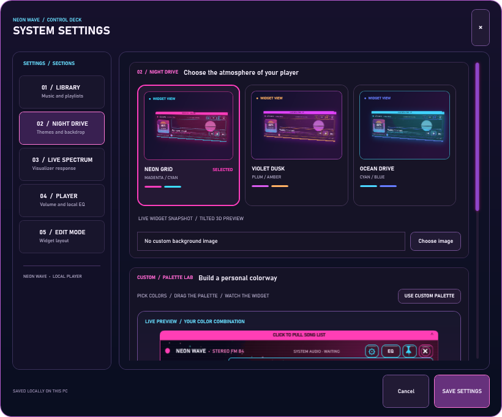

# Waveplayer / SynthWaveVISSC

Waveplayer is a compact Windows music player with a synthwave-inspired interface,
a live spectrum visualizer, local playlists, customizable colors, and Automix.

## Download

[Download the latest Waveplayer update](https://github.com/HASHMSI/Waveplayer/releases/latest).
For a new installation, use the [v1.0.3 setup](https://github.com/HASHMSI/Waveplayer/releases/download/v1.0.3/WaveplayerSetup.exe); it updates to the latest version when first opened.

Installed builds quietly check the latest public GitHub Release on startup. Version
1.0.4 includes the corrected bridge for older single-file installations: its release includes
`WaveplayerPortable.zip`, which their existing updater understands. On the next
launch, the bridge also migrates itself to the multi-file layout from the
same release. New setups install that layout directly from `WaveplayerFiles.zip`. The new
updater accepts a full `WaveplayerFiles.zip` or, when the installed base version
matches, a smaller `WaveplayerPatch.zip`. The latter contains changed files and a
manifest listing every target file with its SHA-256. The updater verifies the
GitHub asset digest and all staged files before replacement, keeps a rollback
copy, and preserves settings under `%LOCALAPPDATA%`. The first move from a
single-file installation to multi-file needs the full package. A source push
alone does not trigger an update.

[▶ Watch the introduction video](promo/Neon-Wave.mp4)




The previews and video show an earlier version of the interface under its
previous name, Neon Wave.

### Features

- Play music from multiple local folders; new files appear in the library while the player is open.
- Keep playback in the notification area when the widget closes. Single/double
  click the palm icon to restore the widget; right-click for playback, settings
  and Exit. Reopening the shortcut restores the same player instance.
- In Player settings choose Original (16 ms × 3 buffers) or optional Stable
  (16 ms × 8 buffers). Buffer mode changes apply to the next track. Stable
  increases audio headroom and output latency; it is not a guarantee against
  driver-related glitches. The original mode remains the default.
- Group playlist tracks by genre or artist tags, and drag tracks into a custom order.
- Choose between Pulse and Glide visualizers.
- Personalize the widget colors, background, and layout.
- Use the built-in equalizer and Classic or Adaptive Automix.
- Estimate major/minor musical key and Camelot notation in the BPM + KEY LAB;
  keys appear after the track duration in the playlist and below the artist
  in the player. Uncertain harmony is marked UNSURE.

## Build the setup from a fresh clone

On Windows, install the .NET 10 SDK and run `./installer/build-setup.ps1` in PowerShell.
The script publishes the player, creates the setup payload, and publishes
`installer/release/WaveplayerSetup.exe`. Generated payloads and local user data
are excluded from Git. The setup project includes short audio previews under
`installer/src/Assets`.

For an update-only release, run `./installer/build-update.ps1`. It creates the
legacy bridge and the full multi-file ZIP. Pass `-BasePayload` pointing at the
previous release's `installer/payload` snapshot to also create the small patch;
keep that snapshot outside the generated `installer/payload` directory. Pass
`-Dotnet` when the SDK is not on `PATH`. Publish the full ZIP and legacy bridge
on each release while pre-1.0.3 users still need direct updates; publish the
patch ZIP when generated. The release tag must be a higher numeric version.

Waveplayer is a compact Windows music player and live chillwave visualizer. This folder contains an untouched snapshot of the previous source and the modular working copy for continued development.

## Layout

Key detection implementation and measured limitations are documented in
[`docs/key-detector-validation.md`](docs/key-detector-validation.md).
Run `dotnet run --project tests/KeyDetectorChecks -c Release` for the generated
signal, tuning, stereo and cancellation checks.

| Path | Purpose |
| --- | --- |
| `backup/source-2026-11-14/` | Source snapshot copied from `F:\CodexScratch\SynthwaveNowPlaying` before the refactor. Keep this as the restore point. |
| `backup/source-pre-beatmix-2026-11-14/` | Working source snapshot immediately before beat-aware Remix changes. |
| `backup/source-pre-bpm-library-2026-11-14/` | Working source snapshot immediately before the BPM library UI and cache. |
| `backup/user-settings-2026-11-14.json` | Snapshot of the current per-user preferences. |
| `src/SynthwaveNowPlaying/` | Current modular source. Open this folder in VS Code. |
| `.build/` | Generated binaries and intermediate files; safe to regenerate. |
| `docs/` | Rendered UI previews for reviewing the widget and settings. |

The original `F:\CodexScratch\SynthwaveNowPlaying` was left unchanged. Both copies read and write the same user preferences at `%LOCALAPPDATA%\NeonWave\settings.json`; the saved settings snapshot above preserves the preferences at backup time.

## Build and run

This project targets **.NET 10 WPF on Windows**. The SDK already installed on this PC is `F:\CodexScratch\.dotnet\dotnet.exe`.

1. Open `F:\SynthWaveVISSC\src\SynthwaveNowPlaying` in VS Code.
2. Run the **Build Synthwave Now Playing** task, or use PowerShell:

   ```powershell
   & 'F:\CodexScratch\.dotnet\dotnet.exe' build 'F:\SynthWaveVISSC\src\SynthwaveNowPlaying\SynthwaveNowPlaying.csproj'
   ```

3. The executable is generated at `F:\SynthWaveVISSC\.build\SynthwaveNowPlaying\bin\Debug\net10.0-windows10.0.19041.0\Waveplayer.exe`. VS Code's **Launch Waveplayer** configuration uses this build. F5 requires a working C# debugger extension.

The checked-in VS Code task uses the local SDK and NuGet cache under `F:\CodexScratch`. When moving the project to another PC, update `.vscode/tasks.json`, `.vscode/settings.json`, and `.vscode/launch.json` for that machine. Package references are NAudio 3.3.0 and TagLibSharp 2.3.0.

## Source map

| Area | Main files | Responsibility |
| --- | --- | --- |
| Window shell | `MainWindow.xaml`, `MainWindow.xaml.cs` | WPF layout, widget size and docking, pin state, render scheduling, lifecycle. |
| UI behaviors | `UI/MainWindow.*.cs` | Local track metadata, playback, cover volume gesture, playlist, album palette, theme previews, edit mode. The files form one `partial MainWindow` class. |
| Audio | `Audio/SpectrumTap.cs`, `Audio/AudioSampleBuffer.cs`, `Audio/SpectrumAnalyzer.cs`, `Audio/LocalEqualizer.cs` | Capture, thread-safe recent samples, FFT bands, local playback filters. |
| Visuals | `Visuals/SpectrumView.cs`, `Visuals/SynthwaveBackground.cs`, `Visuals/AlbumVolumeOverlay.cs` | Spectrum drawing, mouse EQ editing, animated background, and a short-lived water-volume overlay on the cover. |
| Settings | `Settings/AppSettings.cs`, `Settings/SettingsWindow*.cs`, `Settings/ColorPickerPanel.cs` | JSON preferences, section navigation, theme cards, custom palette picker, and window lifecycle. |

### Audio and UI flow

1. SpectrumTap samples the local player after mixing, EQ and limiting.
2. `AudioSampleBuffer` keeps a recent mono sample window. The analysis thread runs `SpectrumAnalyzer`'s cached 1024-point FFT and publishes 56 bands.
3. WPF's composition callback takes the newest completed band set. It pauses continuous rendering once the signal and bar decay have settled.
4. Local files supply the artwork and tags through TagLibSharp. The timeline follows the local NAudio reader. The six-band equalizer is in the **local playback chain only**; it does not change Windows system audio or other applications.
5. Cover colors feed a short palette fade across UI resources, spectrum bars, and backgrounds. Playlist tags and thumbnails load in cancellable batches to keep the popup responsive.

## Library and saved state

Select a music folder in Settings. The library scans its subfolders and recognizes MP3, WAV, AIFF, WMA, M4A, AAC, and FLAC. Actual decoding depends on Windows Media Foundation codecs. M3U, M3U8, and PLS files found under the selected folder appear as playlist sources. Scanning does not start playback.

After a local track finishes, playback advances in the order of the playlist that launched it and wraps to its first track at the end. Browsing another playlist does not change the current playback queue; clicking one of its tracks does. Unreadable tracks are skipped during advancement.

Each song row has a drag handle for changing its position and a trash icon for removing it from the selected in-app list. Edits are stored per source in `%LOCALAPPDATA%\NeonWave\settings.json` and survive folder rescans and restarts. Removing a row never deletes the audio file or edits an M3U/PLS file. The playback queue follows edits to its active source.

**REMIX (DEMO)** beside EQ saves an on/off preference. When enabled, local playlist playback analyses short samples at the beginning and end of the current and next tracks in the background. It skips brief detected intro silence and starts an equal-power crossfade before detected outro silence. When both short windows have a clear, compatible beat, the crossfade starts near an outgoing beat and seeks the next track to its first suitable beat. Uncertain or incompatible estimates use the ordinary crossfade. Both tracks feed one 44.1 kHz stereo mixer and output device, with conditional resampling, modest level matching, and peak protection. This is a lightweight beat estimate, not phrase detection or BPM matching; it does not affect audio from other Windows apps. Pause and cover-volume changes control the shared output during the transition. When disabled, regular end-of-track advancement continues.

Automix measures the final 45 seconds and looks further back if it finds a long silent tail. Sustained drops in level and gentle fade-outs allow longer overlaps, up to 12 seconds. An ending that holds its energy to the last beat gets a shorter overlap. The incoming track's opening level and available playing time also limit the blend. With a reliable compatible beat grid the player can align either a short or a long transition to the beat. Playback refreshes older transition profiles on demand and keeps previously scanned BPM values.

During the transition, a 130 Hz split keeps the two tracks' kick and bass regions from stacking. With a reliable beat grid, the outgoing low band clears just before a beat and the incoming low band enters just after it; otherwise the low bands trade places smoothly around the middle of the fade. Full-band playback outside a transition remains unchanged.

Settings → **Player** selects Classic or Adaptive timing. Adaptive opens the next decoder before the cue and schedules its entry on the output sample clock. A completed BPM scan supplies tempo to a separate local onset check for the intro and outro; BPM alone never supplies an assumed beat phase. Half-time and double-time pulse grids are supported when the local attacks confirm them. Adaptive ranks candidate starts by average voice, drum, and level overlap so longer fades are not penalized just for lasting longer. Two strong, incompatible drum patterns get a shorter overlap, while sparse or quiet endings can blend longer. Voice and room-tail detection are estimates from the audio. A sharp beat ending can send its last hit into two quiet half-beat echoes. A sustained, low-attack outgoing tone can receive a gentle low-pass sweep. A detected decay carries into the next track with its own tail. Uncertain cases use a clean overlap. Classic timing is unchanged. Technical details are in `Audio/TransitionAnalyzer.cs`, `Audio/TransitionFeatures.cs`, `Audio/AdaptiveCues.cs` and `Audio/AdaptiveDeck.cs`.

Settings → **BPM SCAN** spends 20–60 seconds per new result, with immediate reuse of a completed scan. Up to four minutes of music are analyzed in full. For longer songs the scanner checks seven sections spread across the file. The detector compares a broad spectral-onset envelope with one that emphasizes percussion transients, then checks agreement across sections and plausible half-time, double-time, and three-to-two rhythmic aliases. It uses a BPM tag only when the audio does not contradict it. This uses the existing NAudio dependency and adds no runtime package. An estimated value is marked with ≈. Insufficient rhythmic evidence gives UNSURE, and reaching the time limit gives TIMED OUT and allows a retry. Closing Settings cancels the scan. Results are cached in `%LOCALAPPDATA%\NeonWave\track-analysis.json`; the current cache upgrade preserves verified BPM values and recalculates local Automix cues. BPM is metrically ambiguous for some recordings, so ≈ denotes an estimate rather than a guaranteed original production tempo.

Settings include the selected folder, theme/background image, custom primary and secondary colors with color balance, volume, EQ bands, visualizer sensitivity, widget width, and edit-mode placements. The Custom theme keeps the chosen colors while artwork is shown; built-in themes allow artwork-driven colors. Resizing stores the width; the next launch restores that size and docks the widget to the desktop's bottom-right work area. The pin button controls dragging.

Hold the left mouse button on the album cover and drag vertically to change **local app volume**. Up raises it and down lowers it. Ordinary pointer movement and the mouse wheel do not change volume. The water level and percentage fade away after the drag stops. The gesture is disabled in Edit Mode, and the overlay scales with the cover.

## UI previews

The Settings window shows theme previews captured from the actual widget. Hovering a built-in theme opens a larger animated preview. The Custom Palette section has a hue and saturation picker, swatches, exact hex fields, a color-balance control, and a live widget preview.

- [Settings and preset themes](docs/preview-settings.png)
- [Expanded theme preview](docs/preview-theme-hover.png)
- [Custom palette editor](docs/preview-settings-custom.png)
- [Cover volume overlay](docs/preview-cover-volume.png)

## Restore point

To return to the pre-refactor source, copy `backup/source-2026-11-14/` into a **new** folder and build it there. Its `Directory.Build.props` still targets the old `F:\CodexScratch\build` output path. The snapshot was not modified during modularization.

## Installer

The Windows setup is at `installer/release/WaveplayerSetup.exe`. It contains a self-contained player build, the original Pulse visualizer assembly, and a configuration walkthrough. The installer source is in `installer/src/`. The existing per-user settings remain under `%LOCALAPPDATA%\NeonWave` for compatibility with earlier builds.

## With love by MSIHASH X SENIOR B 💜
